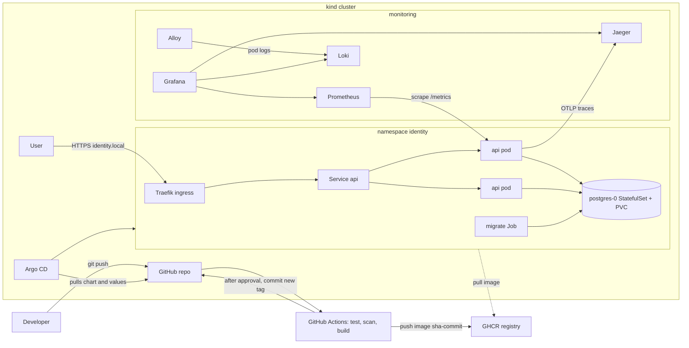

# Architecture

## Components

| Component | Kind | Why it exists |
|---|---|---|
| api | Deployment, 2 to 4 pods | Runs the Express app. It keeps no state, so any pod can serve any request. |
| postgres | StatefulSet, 1 pod, 1 Gi PVC | Stores contacts. It needs a stable name and a volume that follows the pod. |
| migrate | Job, an Argo CD sync hook | Runs `prisma migrate deploy` once per sync, after Postgres is ready and before new api pods start. |
| Traefik | Deployment on the control-plane node | Ingress controller. Terminates TLS and routes only the public paths. |
| Argo CD | Helm release in `argocd` | Keeps the cluster equal to the chart in git. |
| Prometheus, Alertmanager, Grafana | kube-prometheus-stack | Metrics, alert rules and dashboards. |
| Loki and Alloy | Helm releases | Alloy reads pod logs on each node and sends them to Loki. |
| Jaeger | Deployment | Receives OpenTelemetry traces and shows them. |
| metrics-server | Helm release | Gives the HPA pod CPU numbers. |

The kind cluster has one control-plane node and two workers. The workers carry the labels `topology.kubernetes.io/zone=zone-a` and `zone-b` to stand in for two availability zones.

## Request path

1. The client calls `https://identity.local/identify`. kind maps port 443 on the laptop to the control-plane node.
2. Traefik terminates TLS with the `identity-tls` secret. It matches the host and the exact path `/identify`, then forwards to the `api` Service. Paths such as `/metrics` get a 404 at this point.
3. The Service sends the request to a ready api pod. A pod that fails `/readyz` is removed from the Service endpoints.
4. The app opens a transaction, takes advisory lock 1, reads the matching contacts, writes any new or changed rows and commits.
5. The response goes back the same way. The app records the request in `http_requests_total` and `http_request_duration_seconds`, logs one JSON line with the trace id, and sends the trace spans to Jaeger.

## Commit to running pod

1. A push runs the `ci` workflow. `test` runs type checks plus unit and integration tests against a Postgres service container. `security` runs gitleaks and `npm audit`. `chart` runs `helm lint` and a Trivy config scan.
2. `image` builds the Docker image with the commit SHA baked in as `GIT_SHA` and `APP_VERSION=sha-<7 chars>`. Trivy scans it for critical CVEs. The job pushes it to `ghcr.io/harsh-kumar-patwa/identity-reconciliation-service:sha-<7 chars>`.
3. `release` waits for approval on the GitHub `dev` environment. After approval it changes `image.tag` in `values-dev.yaml` and commits as `github-actions[bot]`.
4. Argo CD polls the branch every 3 minutes, renders the chart with `values.yaml` and `values-dev.yaml`, and applies it in waves. Postgres is wave -1, the migration Job is wave 0, and the api Deployment, HPA and PDB are wave 1.
5. The Deployment rolls out with `maxUnavailable: 0`. A new pod gets traffic only after `/readyz` passes, and an old pod is removed only after that.
6. `/version`, the pod label `app.kubernetes.io/version` and the Grafana "Running version" panel all show the new tag.

## Failure boundaries

| What fails | What users see | What limits the damage |
|---|---|---|
| One api pod | Nothing | Other pod keeps serving. The liveness probe restarts a hung process. |
| One worker node | Nothing for api traffic, measured 0 failed requests during a drain | Two api pods, PDB `minAvailable: 1`, pods spread across zones |
| Postgres pod | 500s on `/identify` for a few seconds | StatefulSet recreates the pod, the PVC keeps the data. Readiness removes api pods if the outage lasts longer than 10 seconds. |
| Postgres volume | Data loss | Not covered. See known limitations in the README. |
| Traefik or the control-plane node | Full outage | Not covered on a laptop. A cloud load balancer and several ingress replicas would cover it. |
| GitHub, GHCR or CI | No new deploys | Running pods keep working. Argo CD retries when git is back. |
| A bad release | Errors or latency | Rolling update with readiness gating, burn-rate alerts, rollback by `git revert` |

## Network rules

A `default-deny-ingress` NetworkPolicy blocks all incoming traffic in the `identity` namespace. Two policies then open what is needed.

- The api pods accept port 3000 from the `traefik` and `monitoring` namespaces.
- Postgres accepts port 5432 only from pods labelled `app=api` or `app=migrate`.

The namespace also enforces the Pod Security `restricted` profile. Every pod must run as non-root, drop all Linux capabilities and use the default seccomp profile.

## Mapping to a cloud setup

The same design moves to a cloud provider with few changes.

| Here | In AWS |
|---|---|
| kind workers labelled zone-a and zone-b | EKS node groups in two availability zones |
| Traefik with host ports | An AWS Load Balancer in public subnets in front of the ingress controller |
| NetworkPolicy | Security groups between subnets, plus NetworkPolicy inside the cluster |
| Postgres StatefulSet | RDS Postgres with Multi-AZ and automated backups |
| Secret from a script | AWS Secrets Manager with External Secrets |
| Self-signed certificate | ACM or cert-manager with Let's Encrypt |

## Troubleshooting commands used

These are the commands that came up while building and testing this setup.

- `kubectl get pods -o wide`, `kubectl describe`, `kubectl logs` and `kubectl get events` for pod state and scheduling problems. A Traefik rollout stuck on a host port was found through a `FailedScheduling` event.
- `kubectl top nodes` and `docker stats` for CPU and memory on the kind nodes.
- `curl -v --resolve identity.local:443:127.0.0.1` to test the ingress path without touching DNS.
- `openssl s_client` to check which certificate Traefik serves.
- `nslookup` and `curl` to the registry, to find out that image pulls failed because of DNS on the laptop.
- `kubectl exec ... psql` to count rows before and after the Postgres failure test.
